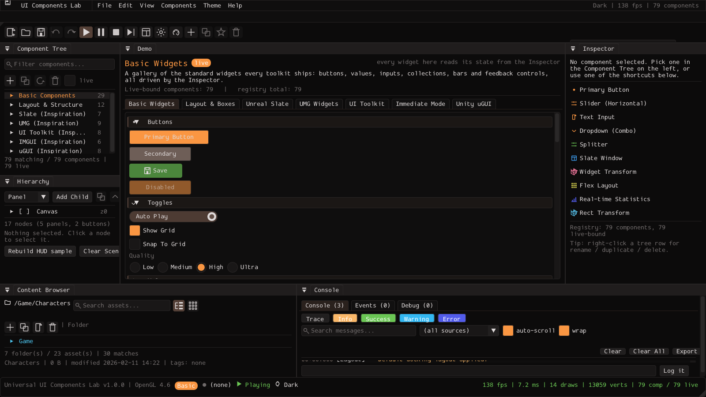
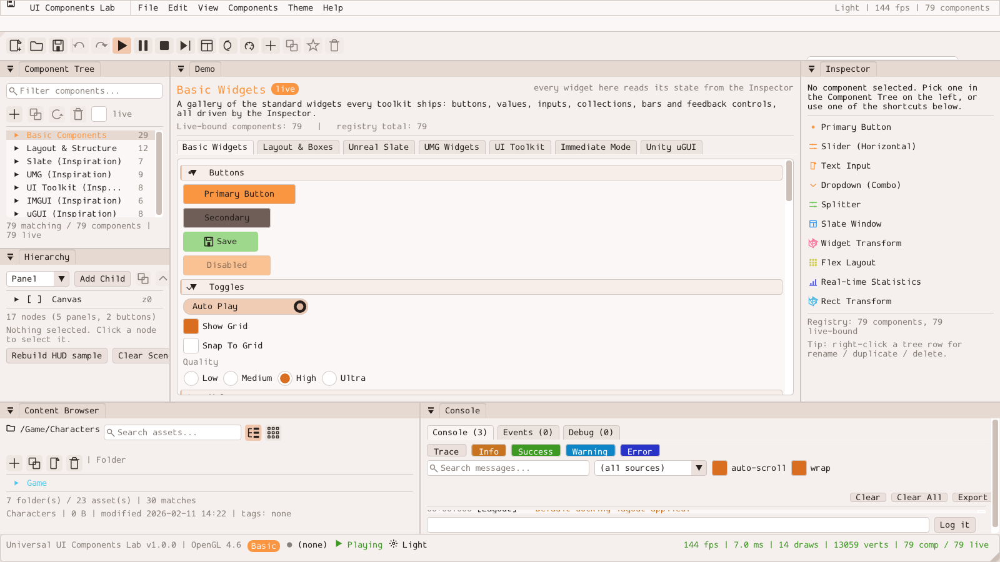
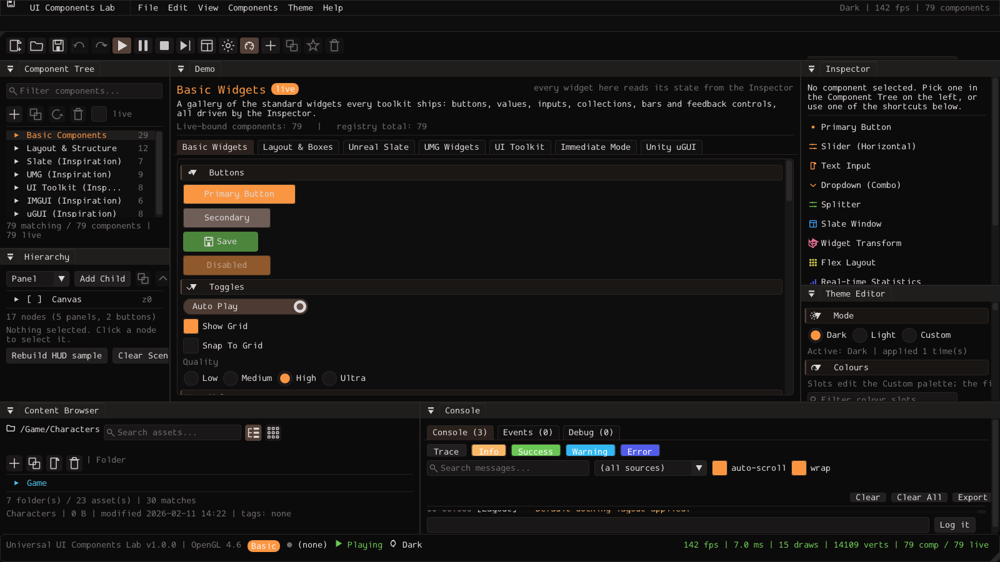
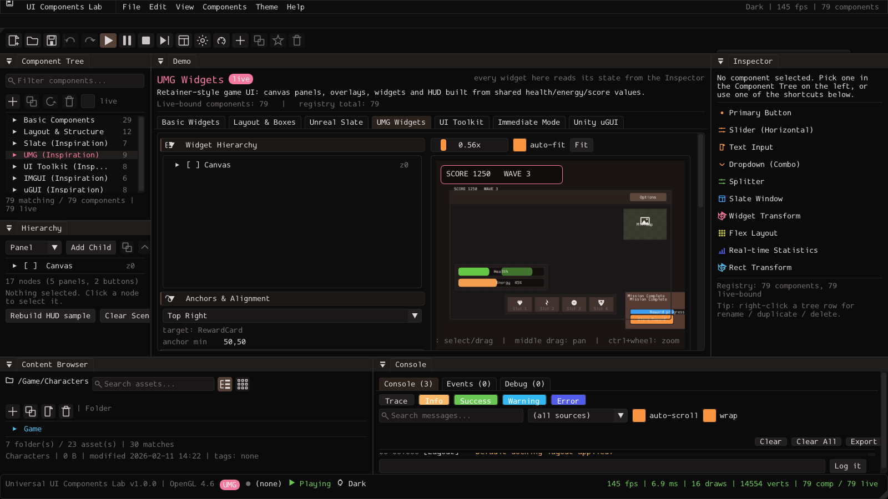

# Universal UI Components Lab

An interactive laboratory of UI components and patterns, in C++17 with Dear ImGui.
It reproduces the *editor feel* of Unreal Engine (Slate / UMG) and Unity
(UI Toolkit, IMGUI, uGUI) in one self-contained desktop app: a dockable inspector,
component tree, console, content browser and theme editor around a page per paradigm.

Everything is generated at runtime — icons are vector paths, textures are procedural,
the "Content" folder and the canvas scene are built in memory. No engine code and no
binary assets are used.

## Screenshots

Editor with the near-black Dark theme:



The same layout in the Light theme:



Theme Editor panel docked in the Inspector column:



UMG inspiration page with the live HUD preview:



All four were captured by the app itself (`--screenshot=PATH --frames=N` reads back
its own framebuffer — see [Running](#running)); regenerate them with:

```bat
build\bin\Release\UniversalUIComponentsLab.exe --no-maximize --width=1600 --height=900 --frames=120 --screenshot=shots\editor-dark.bmp
build\bin\Release\UniversalUIComponentsLab.exe --no-maximize --width=1600 --height=900 --frames=120 --theme=light --screenshot=shots\editor-light.bmp
build\bin\Release\UniversalUIComponentsLab.exe --no-maximize --width=1600 --height=900 --frames=120 --show-theme-editor --screenshot=shots\theme-editor.bmp
build\bin\Release\UniversalUIComponentsLab.exe --no-maximize --width=1600 --height=900 --frames=120 --page=UMG --screenshot=shots\demo-umg.bmp
```

## Build

Dependencies are pinned git revisions under `third_party/`; if a folder is missing,
CMake fetches it with `FetchContent` (`UILAB_FETCH_DEPS`, on by default).

| Dependency | Revision |
| --- | --- |
| Dear ImGui | `v1.93.0-docking` |
| GLFW | `3.5.1` |

Windows (Visual Studio 2022/2026, CMake ≥ 3.16):

```bat
cmake -S . -B build
cmake --build build --config Release
build\bin\Release\UniversalUIComponentsLab.exe
```

Linux / macOS:

```sh
cmake -S . -B build -DCMAKE_BUILD_TYPE=Release
cmake --build build -j
./build/UniversalUIComponentsLab
```

OpenGL 3.3+ and a desktop window are required (the app clears to the theme's canvas
colour and renders entirely through ImGui).

## Running

```
UniversalUIComponentsLab [options]
  --width=N --height=N   initial window size (default 1680x980)
  --no-maximize          start windowed instead of maximized
  --frames=N             render N frames and exit (visual smoke test)
  --self-test            run the headless logic checks and exit
  --verbose              also list the checks that passed
  --no-docking           open panels as floating windows instead of a dockspace
  --no-vsync             disable vsync
  --layout=PATH          use another docking ini file
  --page=NAME            start on a demo page: index, or a fragment of its name
                         (basic, layout, slate, umg, toolkit, immediate, ugui)
  --theme=NAME           start with the Dark, Light or Custom theme
  --show-theme-editor    open the Theme Editor panel at startup
  --screenshot=PATH      write a 24-bit BMP of the last rendered frame to PATH
                         (frame N with --frames=N, otherwise frame 60)
```

`--self-test` needs no window, no OpenGL and no ImGui frame; it exits non-zero when a
check fails, which makes it usable as a build gate.

`--screenshot` reads back the window's own framebuffer, so it captures the app only —
combine it with `--page` and `--frames` to script one image per paradigm page.


## Using as a library

The lab is three namespaced targets plus an optional executable. Nothing under
`src/` except `src/main.cpp` and `src/app/` owns a window, a GL context or `main()`;
the libraries only ever draw into an ImGui frame the host already began.

| Target (`UILab::`) | Built from | Provides |
| --- | --- | --- |
| `Core` | `src/core`, `src/themes`, `src/ui`, `src/canvas` | `AppContext`, `WidgetRegistry`, undo/validation/event log/toasts/dialogs/settings/serialisation, themes, shared widgets, vector icons, procedural textures, `CanvasScene` |
| `Editor` | `src/layout`, `src/panels` | the dockable panels and the default docking tree |
| `Demos` | `src/demo` | the seven paradigm pages and the mini USS engine |

### From source

```cmake
add_subdirectory(../imgui imgui-build)          # your own ImGui + backends
add_subdirectory(../glfw  glfw-build)

set(UILAB_PROVIDE_THIRD_PARTY OFF)              # the host supplies ImGui/GLFW
set(UILAB_IMGUI_TARGET "imgui::imgui" CACHE STRING "")
set(UILAB_GLFW_TARGET  "glfw"         CACHE STRING "")
set(UILAB_BUILD_APP    OFF)                     # you already have an executable

add_subdirectory(../UniversalUIComponentsLab uilab-build)
target_link_libraries(my_app PRIVATE UILab::Editor UILab::Demos)
```

`examples/host-integration/` is a runnable version of exactly this: it builds ImGui
(with `imgui_demo.cpp`) and GLFW itself, then pulls the lab in with the switches above.

### From an install

```bat
cmake --install build --prefix C:\dev\uilab
```

```cmake
find_package(UILab REQUIRED COMPONENTS Core Editor Demos)
target_link_libraries(my_app PRIVATE ${UILab_LIBRARIES})
```

Headers install under `<prefix>/include/uilab`, so the include paths are the same ones
used inside this tree (`#include <uilab.h>`, `#include "panels/Panels.h"`). The package
config looks for OpenGL only — ImGui and GLFW must already exist in the consumer as the
imported names recorded when the lab was configured.

### Options

| Option | Default | Effect |
| --- | --- | --- |
| `UILAB_BUILD_APP` | `ON` | build the standalone executable |
| `UILAB_BUILD_EDITOR` | `ON` | build the panels library |
| `UILAB_BUILD_DEMOS` | `ON` | build the demo pages library |
| `UILAB_SHARED_LIBS` | `OFF` | build the `uilab_*` libraries as DLLs/shared |
| `UILAB_FETCH_DEPS` | `ON` | `FetchContent` a dependency when its `third_party/` folder is missing |
| `UILAB_PROVIDE_THIRD_PARTY` | `ON` | create the `uilab_imgui` / glfw targets here; `OFF` hands that to the host |
| `UILAB_EXPORT_TARGETS` | `ON` | add the install and package-export rules |
| `UILAB_WARNINGS_AS_ERRORS` | `OFF` | `/WX` (or `-Werror`) for the lab targets |

Shared builds on Windows rely on `WINDOWS_EXPORT_ALL_SYMBOLS` because the public
classes carry no `__declspec` annotations; static linking needs no header changes.

### Drawing a frame from the host

```cpp
#include <uilab.h>
#include <layout/DockingLayout.h>
#include <panels/Panels.h>
#include <demo/DemoHost.h>

uilab::AppContext ctx;                       // model + theme + log, no window
ctx.scene.BuildDefaultScene();               // the canvas panels start empty otherwise
uilab::layout::BeginFrame(ctx);              // dockspace over the work area
uilab::panels::DrawMenuBar(ctx);
uilab::panels::DrawComponentTree(ctx);
uilab::panels::DrawInspector(ctx);
uilab::demo::DrawHost(ctx);                  // the paradigm pages
uilab::panels::DrawStatusBar(ctx);
```

`src/app/Application.cpp` is the complete version of that sequence — window creation,
backends, input, play/pause clock, layout persistence and the frame loop, in ~120 lines
of glue around the calls above.

## What is where

| Panel | File | Shows |
| --- | --- | --- |
| Component Tree | `src/panels/ComponentTreePanel.cpp` | every `WidgetInstance`, grouped by category |
| Hierarchy | `src/panels/HierarchyPanel.cpp` | the canvas scene outliner (UMG/uGUI nodes) |
| Inspector | `src/panels/InspectorPanel.cpp` | the selected component's `WidgetState` |
| Console | `src/panels/ConsolePanel.cpp` | console / events / debug channels with filters |
| Content Browser | `src/panels/AssetBrowserPanel.cpp` | the in-memory asset tree |
| Theme Editor | `src/panels/ThemeEditorPanel.cpp` | palette slots, style metrics, preview |
| Status Bar | `src/panels/StatusBarPanel.cpp` | selection, fps, draw calls, log counters |
| Demo | `src/demo/DemoHost.cpp` | one tab per paradigm, rendered **from** the state |

The wiring that matters: a component's `liveBound` flag means a demo page reads its
`WidgetState` every frame, so Inspector edits appear in the preview immediately.

Keyboard: `Ctrl+Z`/`Ctrl+Y` history, `Ctrl+C`/`Ctrl+V` copy-paste properties,
`Ctrl+D` duplicate, `Delete` remove component, `Ctrl+L` reset layout,
`F2` theme, `F5`/`F6`/`F7` play-pause-stop, `F11` debug overlay.

## Layout of the source

```
src/main.cpp            command line -> Application
src/app/                window, ImGui backends, per-frame orchestration
src/layout/             dockspace host + default docking tree
src/core/               types, registry, undo, validation, log, toasts, dialogs, settings, serialisation
src/themes/             Dark / Light / Custom palette + style metrics (persisted as text)
src/ui/                 shared widgets, vector icons, procedural textures
src/canvas/             CanvasScene (anchors, pivots, layout groups) + interactive renderer
src/panels/             the dockable panels
src/demo/               the seven demo pages, the mini USS engine and the self-test
```

## Saved state

Written next to the working directory, all plain text and all disposable:

- `imgui.ini` — ImGui window state (disabled: the docking layout uses the file below)
- `default_layout.ini` — docking layout (`--layout=PATH` to relocate)
- `assets/themes/uicomp.ui-theme` — custom palette and style metrics
- `logs/ui-components-lab.log` — exported console log
